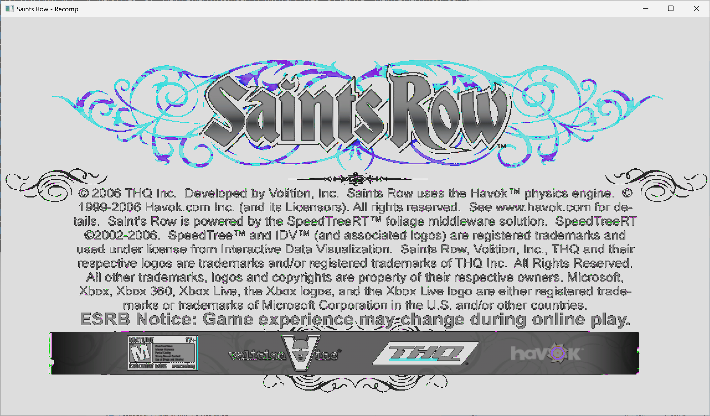
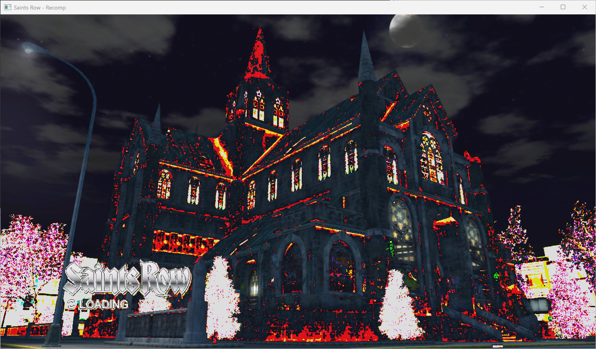

# Saints Row (Xbox 360, 2006) - Static Recompilation

**Status: Boots to the main menu -- real input, correct swap format**




Static recompilation of Saints Row for Xbox 360 to native x86-64 PC executable using [XenonRecomp](https://github.com/hedge-dev/XenonRecomp) and [ReXGlue SDK](https://github.com/rexglue/rexglue-sdk).

Saints Row (2006) was an Xbox 360 exclusive and has never been ported to PC, making it a compelling preservation target.

## Background

This project uses the same toolchain proven across multiple Xbox 360 titles:
- [360tools](https://github.com/sp00nznet/360tools) -- Extraction, analysis, and project templates
- [XenonRecomp](https://github.com/hedge-dev/XenonRecomp) -- PowerPC to C++ static recompiler
- [ReXGlue SDK](https://github.com/rexglue/rexglue-sdk) -- Xbox 360 runtime (kernel, D3D12 GPU, audio, input)

## Project Complexity

Saints Row is a large open-world game -- significantly more complex than the arcade ports and smaller titles that have been successfully recompiled so far. Key challenges:

- **Scale**: Large PE image with tens of thousands of functions
- **Open world**: Streaming world data, LOD systems, AI systems
- **Physics**: Havok physics engine integration
- **Audio**: Complex multi-channel audio with environmental effects
- **Networking**: Xbox Live stubs needed for save/profile systems

## Pipeline

```
Saints Row.iso
    |
    v
[ extract_iso.py ]          -- Extract game files from XDVDFS disc image
    |
    v
[ extract_pe.py ]           -- Decrypt XEX2 + decompress PE image
    |
    v
[ find_abi_addrs.py ]       -- Locate PPC ABI helpers
[ extract_switch_tables.py ] -- Map jump tables
[ xex_info.py ]             -- Analyze XEX2 headers
[ parse_xex_imports.py ]    -- Identify kernel/XAM imports
    |
    v
[ XenonRecomp ]             -- PowerPC -> C++ static recompilation
    |
    v
[ ReXGlue SDK ]             -- Xbox 360 runtime environment
    |
    v
Native x86-64 .exe          -- Saints Row on PC
```

## Progress

- [x] Acquire game ISO
- [x] Extract ISO contents (375 files from XGD2 disc)
- [x] Extract and analyze XEX2 binary (33.4 MB PE, 12 sections, Bink middleware)
- [x] Find ABI helper addresses (8/10 found, no setjmp/longjmp)
- [x] Analyze kernel imports (266 kernel + 204 XAM)
- [x] Run XenonRecomp first pass (33,725 functions -> 122 MB C++)
- [x] Resolve unrecognized instructions (vandc, mulhdu, frsqrte, dcbst)
- [x] Create project scaffold (CMake + ReXGlue SDK v0.10.0)
- [x] First compilation (45 MB native x86-64 executable)
- [x] First boot -- game entry point executes, loads all packfiles
- [x] D3D12 GPU initialization (NVIDIA RTX 5070, ROV, tier 3)
- [x] Audio system (XMA decoder + SDL audio)
- [x] Game creates 14+ worker threads (physics, streaming, etc.)
- [x] Bink video decode -- both splash videos decode and audio plays
- [x] Game state machine -- transitions through all loading phases (state 1 -> 2 -> 3)
- [x] Content loading system -- all 151 items loaded (~30-60 seconds)
- [x] VdSwap/IssueSwap -- frames present to D3D12 swap chain
- [x] GPU ring buffer pipeline -- PM4 indirect buffers with circular wrap
- [x] GPU command processor -- processes 4500+ kicks, executes draw calls
- [x] Shader compilation -- 9 shaders, 5 graphics pipelines (including 3D game rendering)
- [x] Render targets created (1280x2048 color + depth at EDRAM base 0/720)
- [x] D3D12 presenter connected to window
- [x] **3D game content visible** -- Saints Row logo, cathedral, loading screen rendered
- [x] Game loop stable at 6500+ frames
- [x] Fix presentation flicker -- atomic swap guard, every-frame IssueSwap from GL2_Render
- [x] Fix tiling artifacts -- linear fetch constants for D3D12 framebuffer (sky now renders correctly)
- [x] Fix PM4 packet overflow -- virtual→physical memcpy for render IBs, zero-gap scanner fix
- [x] Fix ring buffer overflow -- zero physical memory on init and wrap-around
- [x] Streaming IO pump in all game states (world loading continues in state 3)
- [x] Headless static-analysis pipeline (IDA Pro + Ghidra) byte-aligned to the recomp image
- [x] Boot/splash sequence confirmed to complete naturally (state 1 -> 2 -> 3, 151-item queue drains)
- [x] Root-caused the post-boot crash to a re-entrant IO-init null deref (see below)
- [x] Rebase onto ReXGlue SDK 0.10.0 (manifest codegen, ReXApp, GPU plugin)
- [x] Boot past the 151-item content queue: state 1 -> 2 -> 3, front-end .xtbl loading starts
- [x] Trace the front-end-init abort to a missing IO format handler and unblock it
- [x] Register the vtable-only entry points codegen folds into neighbouring functions
- [x] **Front-end init completes** -- byte_8370DA94 sets, the 500ms fade runs, the main loop enters sub_82186C10
- [x] Game loop cycles (GameLoop2 / GL2_Init / GL2_World / GL2_Spawn) and the GPU receives PM4_DRAW_INDX
- [x] Survive unregistered indirect calls instead of aborting (SDK patch) -- runs 50s+ instead of ~15s
- [x] Restore presentation over the ring buffer (host-submitted PM4_XE_SWAP)
- [x] Stop clobbering vertex fetch 0 from the swap -- resolve failures 3037 -> 25 per run
- [x] Clear the tiled bit in the game's own swap packet (fixes the colour cast)
- [x] Drop the synthetic controller input; the SDK's real SDL input drives the game now
- [ ] Game sits on the copyright screen after the main menu
- [ ] The front-end fade (flt_8370D1A4) stalls at 0, so byte_8370DA95 never sets
- [ ] Restore presentation on the ring-buffer path (PM4 Type0 overflow)
- [ ] Fix remaining color tint on highlights (red cast on bright areas, pink trees)
- [ ] Input system (controller navigation past menus)
- [ ] In-game rendering
- [ ] Gameplay

### Current Architecture

The game boots through Bink video playback (THQ/Volition logos), then loads 151 content items via a streaming IO pipeline: StreamCallback -> IOComp -> ResLookup -> BufAlloc -> IORead -> IOWork. Loading uses KeInitializeSemaphore preservation to maintain IO thread synchronization across re-initialization cycles, with multi-pump StreamCallback (8x per GameUpdate) for parallel IO dispatch.

After loading, PostLoop5 runs the main game loop calling GL2_Render at ~30fps. The GPU command processor receives PM4 commands via the primary ring buffer (physical memory writes with circular wrap-around), follows INDIRECT_BUFFER_PFD references to secondary buffers containing draw calls, and compiles 5 graphics pipelines including 3 game-specific 3D rendering shader pairs with lighting and texture sampling.

### Key Technical Fixes

- **KeInitializeSemaphore override**: Preserves native semaphore objects when game reinitializes IO semaphores, preventing orphaned IO threads
- **Audio deadlock fix**: Skip XAudioRegisterRenderDriverClient on re-init (sub_82600A68 acquires global_critical_region_ held by audio callback)
- **Ring buffer physical memory**: Write INDIRECT_BUFFER_PFD to physical memory (not virtual) so command processor can read them
- **Ring buffer wrap-around**: Circular write position prevents game loop kicks from being silently dropped
- **Virtual→physical memcpy**: Game writes PM4 to virtual memory but CP reads physical -- copy render IB data before creating indirect buffer references
- **PM4 zero-gap scanner**: Stop at first zero instead of skipping -- CP interprets zeros as Type0 packets causing misalignment and overflow errors
- **Linear fetch constants**: D3D12 framebuffer is linear, not Xenos-tiled -- clearing tiled bit fixes crosshatch artifacts and sky color
- **Atomic swap guard**: Prevent CallInThread queue buildup with atomic swap_pending flag -- eliminates presentation flashing
- **Ring buffer zero-fill**: Zero physical memory on init and wrap to prevent stale loading-phase PM4 data from causing overflow errors
- **Null page threshold**: Guest addresses < 256MB treated as null dereferences to prevent demand-page exhaustion
- **VEH ultra-fast path**: Handles bad vtable dispatches at fault_addr=0x8000001E without overhead

### SDK 0.10.0 Rebase (2026-09-04)

Moved from ReXGlue 0.7.0 to 0.10.0 (321 upstream commits). What changed on our side:

- **Manifest codegen.** `config/saintsrow_rexglue.toml` became `project/saintsrow_manifest.toml`
  with `[project]` / `[entrypoint]` sections. The ABI helper addresses
  (savegprlr/restgprlr/savefpr/restfpr/savevmx/restvmx) are auto-detected now, so they are gone
  from the config. Codegen is incremental and runs as a build step; a full regen is ~8s.
- **Adjustor thunks must be declared.** 0.10.0's scanner does not emit the packed
  8-byte `addi rX,rX,-N; b target` thunk tables, because only vtables reference them --
  an indirect call through one aborts with "Call to invalid or unregistered function".
  The manifest now declares the 40 missing thunks plus the 9 branch targets they jump to,
  found by scanning for runs of >= 3 consecutive thunk pairs.
- **ReXApp.** `main.cpp` no longer hand-rolls runtime setup, window creation and module
  launch; `SaintsRowApp` derives from `rex::ReXApp` and overrides only `OnPreSetup`
  (GPU plugin), `OnConfigurePaths`, `OnPostLoadXexImage` (null page + VEH) and
  `OnPreLaunchModule` (watchdog). Roughly 150 lines of bootstrap deleted.
- **Recomp macro rename.** `PPC_FUNC`/`PPC_FUNC_IMPL` -> `REX_EXTERN`, `PPC_LOAD_*`/`PPC_STORE_*`
  -> `REX_LOAD_*`/`REX_STORE_*`, `ppc_pvoid_t`/`ppc_pu32_t`/`ppc_u32_t` -> `mapped_void`/
  `mapped_u32`/`u32`, `rex::HostToGuestFunction` -> `rex::ppc::HostToGuestFunction`.
  Generated symbols are `extern "C"` now, so stub overrides must be too.
- **The GPU moved behind a plugin.** `rexgpu-xenos.dll` exports only `rex_gpu_create`, so
  `CommandProcessor::IssueSwap` / `CallInThread` / `InvalidateGpuMemory` /
  `WriteRegistersFromMem` are no longer reachable from the host. `InitializeRingBuffer` and
  `EnableReadPointerWriteBack` survive as `IGraphicsSystem` virtuals; everything else now
  goes through the GPU MMIO window at `0x7FC80000` (`0x01C5` = CP_RB_WPTR, `0x4800..` =
  fetch constants). The "force an IssueSwap from GL2_Render" presentation hack is gone.
- **Abort diagnostics.** `REX_FATAL` ends in `std::abort()`, which names no guest code.
  A `SIGABRT` handler now dumps the aborting guest thread's `PPCContext`, so an invalid
  indirect call reports its exact call site (`lr`) and target.

Two SDK patches are still required on top of v0.10.0 and are re-applied to the source tree:
`CommandProcessor::ExecuteIndirectBuffer`/`ExecutePacket` need a `count == 0` guard (a
zero-capacity `RingBuffer` divides by zero in `set_write_offset`), and `XexModule::ReadImage`
must skip `LookupHeap(base)->Reset()`, which wipes the function dispatcher's allocation.

**Where it gets to now.** Further than the 0.7.0 build: the boot state machine advances
1 -> 2 -> 3, the 151-item content queue drains completely, and front-end init starts loading
`.xtbl` tables (`death_faces`, `focused_audio`, `voice_distances`, `reverb`, ...). The old top
blocker -- the re-entrant IO-init crash loop -- no longer fires.

**Current blocker, traced end to end.** `sub_82105FE8` iterates a list at `[r26+8]` and makes a
virtual call on each entry. The entry is null, so the vtable read returns garbage and the call
target is `0x0000000F`. Walking it back:

```
sub_82105FE8   virtual-calls a null list entry                -> abort, target 0x0000000F
  <- slot filled only when sub_8260F990 returns >= 0 (the game never checks)
sub_8260F990   returns 0x80004001 (E_NOTIMPL)
sub_826243D8   returns 0x80004001 from its vtable call
sub_82610168   answers E_NOTIMPL when the handler lookup comes back null
sub_8260FF68   handler-registry lookup misses
```

`sub_8260FF68(registry, idx)` resolves an IO format handler: `idx <= 127` indexes the table at
`[registry+12]` bounded by `[registry+8]`, higher indices use `[registry+20]`/`[registry+16]`, and
an 8-byte entry counts as registered only when both dwords are non-zero. The registry hangs off
the current IO context (`[ctx+60] - 8`), and `sub_8260C4F8` installs a brand-new context at
`dword_837102B4` on **every** IO-context create -- so the "current" registry is replaced constantly.

Dumping the registry around IO init shows what that costs:

| context | slots filled by `sub_8260CC50` |
| --- | --- |
| first | 0, 1, 2, **3** |
| every later one | 0, 1, 2 |

Two separate defects fall out of that:

- **Slot 3 was being lost.** It is registered once, alongside the first IO init, and every
  subsequent context came up without it. Fixed: `sub_8260FF68` now remembers every registry it has
  seen and, on a miss, resolves against one that still has the slot. Entries are pointers to static
  handler descriptors, so serving one from an older table is safe. Confirmed working in the log
  (`[IOReg] idx=3 missed on ..., served from ...`).
- **Slot 4 is never registered at all** -- not on the first context, not on any later one. Its
  handler pair (`0x821071F8`/`0x82107208`) sits in the static descriptor list at `0x8203B59C`, in
  the same address range as the front-end code that needs it, which points at an ordering problem:
  the front-end looks the handler up before whatever installs it has run. That is the open thread.

**Unblocked (2026-09-04, later).** `sub_8260FF68` now answers a miss from the image's own
master handler list at `0x8203B56C`: five 12-byte `{a, b, n}` records whose `{a, b}` pairs are
exactly, in order, registry slots 0..4. Slots 0..3 match what IO init installs; record 4 is the
one nothing ever registers. Because a record's first two dwords have the same layout as a registry
entry, the record's own guest address can be handed back as the entry. That resolves both the lost
slot 3 and the never-registered slot 4, and front-end init runs to completion:
`byte_8370DA94` sets, the 500ms fade advances, and the main loop enters the real game loop.

What this does not do is explain why nothing registers record 4. Neither `sub_82604D10` /
`sub_8260D518` (hooking it shows the handler table unchanged across the call) nor anything
reachable by an immediate reference to `0x8203B56C` writes these slots. Find the real registrar and
the fallback goes away.

### Reaching the menu: swap format and real input (2026-09-04)

Two fixes came straight out of watching the game run rather than reading logs.

**The colour cast is the tiled bit, cleared in the right place.** `VdSwap` copies the frontbuffer
fetch constant out of the game's D3D9 texture header, and that header has the tiled bit set. Our
framebuffer is linear, so the texture cache detiles linear data and the colours come out wrong.
The fix is to clear bit 31 of the fetch's first dword *in the game's own swap packet*, right after
`VdSwap_entry` writes it into the guest command buffer -- not by injecting a competing fetch write
from an out-of-band present, which is what broke every resolve (see above).

**The synthetic input had to go.** The stubs used to override `XamInputGetState`,
`XamInputGetKeystrokeEx` and `XamInputSetState` to fake a repeating START/A button cycle so the
game would walk itself past attract mode. That explained three things at once: the cathedral
loading screen never appeared (START skipped it), the game went straight to the main menu (A
navigated it), and it then sat mashing buttons at the copyright screen. SDK 0.10 ships a working
input system -- SDL gamepad plus keyboard and mouse -- and `ReXApp` attaches the window to it, so
the overrides are gone and the game now responds to real input. The synthetic versions are in git
history if a scripted walkthrough is ever wanted for automated testing.

### Running stably, and the vertex-fetch clobber (2026-09-04)

Three changes took the game from aborting after ~15s to running indefinitely in the game loop.

**Unregistered indirect calls are no longer fatal.** `InvalidFunctionTrap` in the SDK's
`function_dispatcher.cpp` now logs each distinct `(target, lr)` once and returns instead of calling
`REX_FATAL`. A guest indirect call can land on an address codegen never emitted an entry point for,
and aborting turned every one of those into its own build/run cycle to discover the next. Returning
lets a single run report them all. This is a development aid -- revert it to `REX_FATAL` once the
manifest is complete.

**Presentation goes back through the ring buffer.** The forced `IssueSwap` died with the rebase
(the plugin does not export it). `RbPresent` now builds the same PM4 sequence `VdSwap` does -- a
Type3 `PM4_XE_SWAP` carrying the `'SWAP'` fourcc, frontbuffer physical address, width and height --
appends it to the primary ring buffer and advances `CP_RB_WPTR` through GPU MMIO. The CP picks it
up and calls `IssueSwap` on its own thread. The kick hook and `RbPresent` share one write position
under a mutex, since both append to the same buffer.

**The swap must not write fetch constant 0.** `VdSwap` sets registers `0x4800..0x4805` because it
owns the whole swap. We are injecting an extra present into a stream the game is also driving, and
those registers are *shared* between texture fetch 0 and vertex fetch 0. The resolve path reads
vertex fetch 0 -- `GetResolveInfo` in `graphics/util/draw.cpp` carries the comment "D3D9 HACK:
Vertices to use are always in vf0, and are written by the CPU" -- so writing the swap's texture
fetch there makes every subsequent resolve fail:

| swap writes fetch 0 | failed resolves per run | failed draws |
| --- | --- | --- |
| yes | 3037 | 3043 |
| no | 25 | 25 |

Dropping the write leaves the swap using whatever texture fetch 0 the game's own `VdSwap` last
published, which is what it should have been doing.

**Still black.** The framebuffer at `0x09258000` reads all zeros, so the resolves that now succeed
are not landing there, and the front-end fade `flt_8370D1A4` never advances off 0 (so
`byte_8370DA95`, and with it the transition out of the fade, never happens). Those are the next two
threads.

### Vtable-only entry points (2026-09-04)

Past front-end init the game started aborting on calls to *plausible* code addresses
(`0x82277408`, `0x82277418`, `0x824EAED8`). These are small functions that only virtual dispatch
reaches, so codegen never sees a call and folds them into whatever function precedes them. Two
scans now feed the manifest:

- **Tail-call trampolines** -- `lwz r11,0(rX); ...; mtctr r11; bctr` starting right after a
  blr/bctr and lying inside an already-emitted function. The XEX import thunk table
  (`{0x01<mod><ord>, 0x02<mod><ord>, mtctr, bctr}`, 230 of them) matches the same shape and must be
  skipped -- splitting those breaks the link with undefined `sub_827888xx` symbols.
- **Small vtable leaves** -- addresses appearing in a run of >= 4 consecutive code pointers (a
  vtable) that start after a terminator and reach their own blr/bctr within 16 instructions.

Both need a split-safety check: a split at S is only valid when nothing in `[host, S)` branches to
`>= S` and nothing in `[S, end)` branches to `< S`, or the two halves reference each other's labels
and the generated code will not compile. That check rejects 193 of 280 candidates, and one more
(`sub_826445E8`, reached through a jump table the check cannot see) had to be dropped from the
build error. Declaring *every* vtable slot instead -- all 3743 -- splits functions mid-flow and
breaks game init before the first frame.

Two approaches were tried and rejected on evidence: reusing the first IO context instead of letting
`sub_8260C4F8` build new ones does remove the abort, but the streaming queue then stops draining
(the contexts really are per-request); and replaying registrations through `sub_8260D518` records
nothing, because IO init populates the table directly rather than going through that registrar.

A `SIGABRT` handler dumping the aborting guest thread's `PPCContext` is what made this tractable --
`REX_FATAL` otherwise vanishes into `std::abort()` with no guest call site.

**Presentation regression.** Removing the forced `IssueSwap` exposed a malformed PM4 stream:
the CP reports `ExecutePacketType0 overflow` on the indirect buffers our `sub_825D3580` hook
builds, so frames no longer reach the screen. The hand-built IB path predates 0.10.0's memory
changes -- note the new `REX_PHYS_HOST_OFFSET` (+0x1000 for guest physical >= 0xE0000000, which
covers the primary ring buffer at `0xE98B7000`) -- and needs revisiting.

### Latest Investigation (2026-05-31)

A deep static-analysis pass (IDA Pro headless, byte-aligned to the recomp image, cross-checked against the generated PPC) corrected two long-standing assumptions and pinpointed the real post-boot blocker:

- **Static-analysis tooling fixed.** IDA had been loading the extracted PE with stale section `PointerToRawData` values, shifting all of `.text` by `0xE00` and producing garbage decompilation. Patching section headers so raw offset == RVA gives a byte-exact, fully-decompiling database (18,842 functions) that matches the recomp 1:1.
- **`0x8370F248` is a red herring.** All seven writers set it to `nullsub_2` (a no-op stub) -- it is a hook slot that defaults to doing nothing, not a "physics/world init pointer." Whether it is null or `nullsub_2` is functionally identical.
- **The boot/splash load is NOT stuck.** A loading-diagnostic hook had been reading the wrong address (`0x840BAAE8`, which has zero code references and holds uninitialized data) instead of the real loading-slot array at `0x832BAAE8`. With the correct address, the boot state machine (`sub_822827B0`) advances `1 -> 2 -> 3` on its own and the 151-item content queue drains -- the splash sequence completes.
- **Real blocker: a re-entrant IO-init crash loop.** After boot, the game crash-loops on a deterministic null-object dereference (read at `obj+0x0`/`+0x8`) reached via `StreamCallback (sub_8265F720) -> IOComplete (sub_82604BE8) -> IOCtxCreate (sub_8260C318) -> IOInit (sub_8260CC50)`. `sub_8260CC50` initializes the IO semaphore (`0x832AD66C`), builds the IO queue list-heads, and spawns the IO worker threads (`sub_8260CBA0`). It is meant to run once but is re-entered every frame, re-initializing the semaphore and queues while the worker threads concurrently use them. The VEH masks each fault, but the corruption eventually turns fatal. Proposed fix: a true once-guard on `sub_8260CC50` so the IO subsystem initializes a single time.

### Known Issues

- Game reaches the main menu, then cuts to a copyright screen and sits (current top blocker)
- The front-end fade `flt_8370D1A4` stalls at 0, so `byte_8370DA95` never sets
- Screen capture of the D3D12 window from a script comes back black even while the game is visibly rendering; observations come from running it by hand
- PM4 Type0 overflow on the hand-built indirect buffers -- nothing presents
- Red color tint on bright areas (highlights, trees) -- likely gamma ramp or render target format mismatch
- Scrolling white horizontal bar (screen tearing from unsynchronized IssueSwap)
- Second+ Bink videos blocked (garbage allocation crash)

## Related Projects

- [StilwaterReclaimed](https://github.com/THE-W0RLD/StilwaterReclaimed) -- Saints Row 2 static recompilation (early stage)
- [Halo 3 Recomp](https://github.com/twist84/halo3_cache_debug_recomp) -- Halo 3 cache debug recomp using ReXGlue SDK
- [OpenRow2](https://github.com/KairiFey/OpenRow2) -- Decompilation of the Saints Row 2 PC port
- [Xenia](https://github.com/xenia-project/xenia) -- Xbox 360 emulator with Saints Row compatibility info

## Prerequisites

- Python 3.8+ with `pycryptodome`
- CMake 3.25+, Ninja, Clang 18+ (built here with LLVM 21.1.8 + MSVC 2022 for the Windows SDK)
- MSVC 2022 (for Windows SDK headers)
- [360tools](https://github.com/sp00nznet/360tools)

## License

Tools and scripts in this repo are provided under the MIT License.
