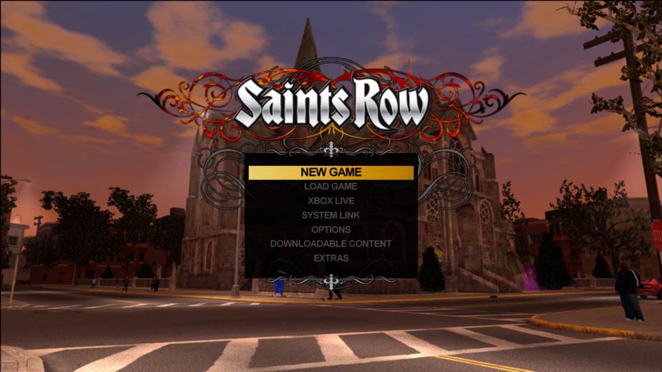
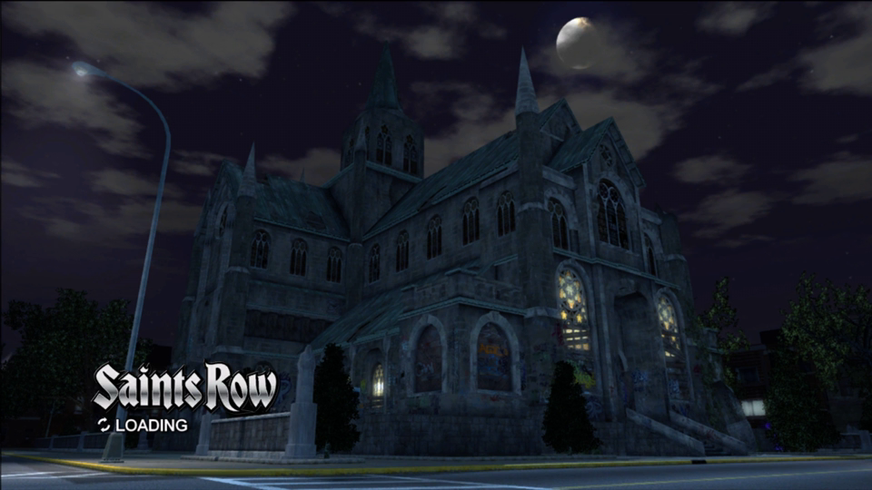
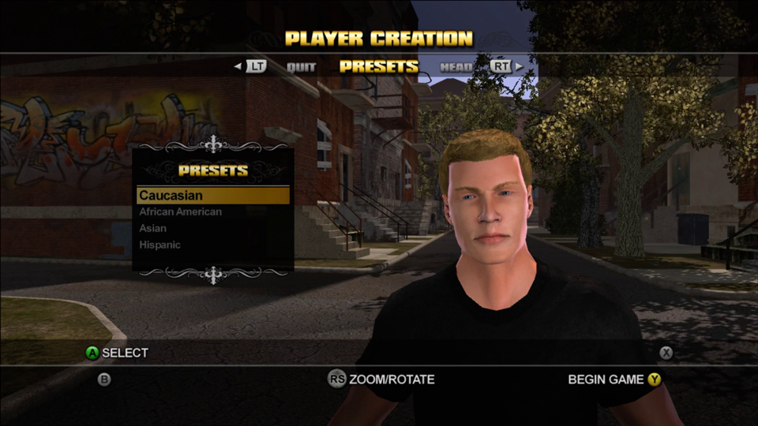

# Saints Row (Xbox 360, 2006) — Static Recompilation

Saints Row's Xbox 360 executable, recompiled from PowerPC to native x86-64 C++ with the
[ReXGlue SDK](https://github.com/rexglue/rexglue-sdk), so it runs on Windows without an emulator.
Saints Row (2006) never had a PC release.

## Status

**Alpha, no release yet.** It boots through the logos, attract mode and the main menu, and New Game
reaches Player Creation, all with correct graphics, audio and controller input. Getting from
Player Creation into the city is the current work.

| Stage | State |
| --- | --- |
| Boot, THQ/Volition logos, legal screen | works |
| Attract mode (city fly-by), main menu | works |
| New Game → cathedral loading screen → Player Creation | works |
| Begin Game → into the city | in progress |
| Load Game | not tested since the 2026-10-20 rebuild |
| Gameplay | not reached |

Known issues and what's next are in [ROADMAP.md](ROADMAP.md); the investigation history is in
[docs/progress-log.md](docs/progress-log.md).

This repository holds no game code or data. The C++ is generated on your machine from your own copy
of the game and is never committed (see [License](#license)).

## Screenshots

Recorded from the recompiled build, 2026-10-20.





## Getting Started

You need your own Saints Row disc (NTSC-U, title ID `545107D1`) as an `.iso`, or its files already
extracted to a folder that contains `default.xex`.

### Quick start

1. Download this repository (green **Code** button → **Download ZIP**) and unzip it somewhere with
   about 20 GB free.
2. Double-click **`Setup.cmd`**.
   - It checks for Git, CMake, Ninja, LLVM/Clang, Python and the Visual Studio C++ Build Tools, and
     asks before installing anything that's missing (through `winget`).
   - It asks for the path to your `.iso` or extracted folder.
   - It then builds the ReXGlue SDK (10–20 minutes the first time) and the game (about 5 minutes).
3. When it prints `Done.`, double-click **`Play.cmd`**.

If it stops, it says what to do in one line and writes the details to `setup.log`. Running it again
picks up where it left off.

### Step by step

These are the same steps `Setup.cmd` runs.

**Prerequisites** (versions this was built with):

| Tool | Version | Install |
| --- | --- | --- |
| Windows | 10/11 x64, D3D12 GPU | |
| Git | 2.4x | `winget install Git.Git` |
| CMake | 3.25+ (4.2.1 used) | `winget install Kitware.CMake` |
| Ninja | 1.11+ | `winget install Ninja-build.Ninja` |
| LLVM / Clang | 18+ (21.1.8 used) | `winget install LLVM.LLVM` |
| VS 2022 Build Tools | "Desktop development with C++" | for the MSVC libraries and Windows SDK |
| Python | 3.8+ | `winget install Python.Python.3.12` (only for extracting an `.iso`) |

**1. Game data.** Extract the disc into `extracted\` at the repository root, using
[360tools](https://github.com/sp00nznet/360tools):

```
git clone --depth 1 https://github.com/sp00nznet/360tools tools\360tools
python -I tools\360tools\tools\extract_iso.py "D:\path\to\Saints Row.iso" extracted
```

It ends with `Extracted 375 files to extracted/`. `extracted\default.xex` must exist.

**2. ReXGlue SDK**, pinned to the `development` commit this was tested with, plus this project's
SDK patches ([docs/sdk-patches/](docs/sdk-patches/)):

```
git clone https://github.com/rexglue/rexglue-sdk tools\rexglue-sdk
cd tools\rexglue-sdk
git checkout -b saintsrow/patches bd833a2ab69d305f99ddf57418fc38ffec8af93d
git am ..\..\docs\sdk-patches\rexglue-development-saintsrow.patch
git submodule update --init --recursive
cmake --preset win-amd64 "-DCMAKE_RC_COMPILER=C:/Program Files/LLVM/bin/llvm-rc.exe"
cmake --build out/build/win-amd64 --config Release
cmake --install out/build/win-amd64 --config Release --prefix out/install/win-amd64
cd ..\..
```

The install ends with `-- Registered rexglue in CMake user package registry`.

**3. The game.** Configuring runs codegen (PowerPC → C++, into the git-ignored `generated\`):

```
cd project
cmake --preset win-amd64
cmake --build build
```

Configure prints `-- Found ReXGlue SDK 0.10.0.28-dev.gb64198f`, and the build ends with
`Linking CXX executable saintsrow.exe`.

**4. Run it:**

```
project\build\saintsrow.exe --game_data_root=extracted
```

**Usual trip-ups**

- `python` opens the Microsoft Store: that's Windows' app alias, not Python. Install Python, or turn
  the alias off in *Settings → Apps → Advanced app settings → App execution aliases*.
- `clang` not found right after installing LLVM: open a new terminal so it picks up the new `PATH`,
  or add `C:\Program Files\LLVM\bin` yourself.
- The SDK build fails on `rexruntime.rc.res`: CMake picked Microsoft's `rc.exe`, which can't read
  clang's preprocessed output. Pass `-DCMAKE_RC_COMPILER=.../llvm-rc.exe` as above, and delete
  `out\build` if an older configure cached `rc.exe`.
- The window takes a minute or more to appear: SDL queries every display adapter Windows knows
  about at startup, and that is slow on machines with many virtual display adapters installed.

## Usage

```
Play.cmd                                  # windowed fullscreen on the primary monitor
Play.cmd --monitor=2                      # on the second monitor
Play.cmd --fullscreen=false               # in a window
Play.cmd --log_flush_interval=1           # flush logs/saintsrow_NNN.log every second
```

Controls: a controller works directly. Keyboard: Enter = Start, Space = A, Tab = Back, WASD = left
stick. The game only reads input while its window has focus.

`SR_AUTOPLAY=1` adds a scripted controller that taps a button every 4 seconds, alternating A and
Y. It
walks the menus and New Game into Player Creation with nobody at the keyboard, and is how test runs
are made:

```
set SR_AUTOPLAY=1
project\build\saintsrow.exe --game_data_root=extracted --monitor=2 --log_flush_interval=1
```

Logs go to `project\build\logs\`. A crash writes the faulting stack to
`project\build\saintsrow_crash.log`.

## Building from source

The pieces and how they fit are in [docs/architecture.md](docs/architecture.md). In short:

- `project/saintsrow_manifest.toml` tells ReXGlue's codegen where the game's code is and lists the
  functions its scanner misses. Codegen runs as a build step.
- `project/src/main.cpp` is the app (window, paths, crash report); `project/src/stubs.cpp` holds
  overrides of game or kernel functions.
- `-DSAINTSROW_LEGACY_STUBS=ON` turns the 0.7-era game overrides back on for comparison. They are
  off by default because the game gets further without them.

## License

The code in this repository (tools, build files, runtime glue and documentation) is MIT; see
[LICENSE](LICENSE). The SDK patches in `docs/sdk-patches/` modify ReXGlue, which is BSD-3-Clause;
see [NOTICE](NOTICE).

The MIT licence does not and cannot cover Saints Row itself. The game's code, art, audio and data
belong to their rights holders, are not distributed here, and you need your own copy to use any of
this. The C++ that codegen generates from the game is a derivative of it and outside the MIT grant
for the same reason. It is made from your own copy and is never tracked in this repository.

## Related projects

- [360tools](https://github.com/sp00nznet/360tools) — extraction and triage tools for Xbox 360 recomps
- [ReXGlue SDK](https://github.com/rexglue/rexglue-sdk) — the recompiler and runtime this is built on
- [StilwaterReclaimed](https://github.com/THE-W0RLD/StilwaterReclaimed) — Saints Row 2 static recompilation
